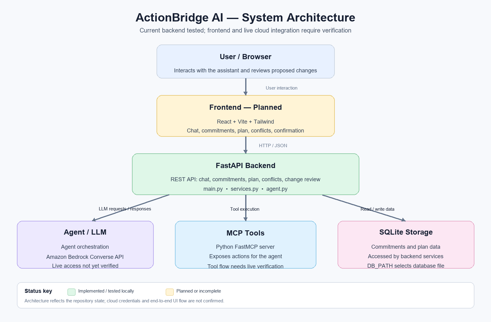

# ActionBridge AI

**A persistent personal action agent that remembers commitments, detects how changes affect a plan, proposes targeted replans, and applies them only after explicit user confirmation.**

ActionBridge AI is submitted as a **simulated Alexa+ agentic experience** in a **web application**. It is not a chatbot and not a to-do list: it keeps persistent context, reasons over that context through an MCP tool workflow, and only acts (changes your real data) after a human confirms.

**Core flow:** Understand → Remember → Reason → Act → Adapt

> A normal assistant may *tell* you that a deadline changed. ActionBridge determines **what that change affects**, proposes an **updated plan**, asks for **approval**, applies it **only after approval**, and **remembers the result**.

---

## Quick Start for Judges / Reviewers (no API key required)

The **recommended reviewer path is deterministic offline Demo Mode**. It needs **no Gemini API key and no AWS credentials** and runs the full agent → MCP → services → SQLite loop end to end.

> Demo Mode is honestly described as a **deterministic offline / reviewer demo mode**. It is a rule-based provider, **not** a full LLM.

```bash id="ybgz2k"
# 1. Clone
git clone https://github.com/Soha-025/ActionBridge-AI.git
cd ActionBridge-AI

# 2. Backend — create a virtual environment and install dependencies
python -m venv .venv
source .venv/bin/activate          # Windows: .venv\Scripts\activate
pip install -r backend/requirements.txt

# 3. Start the backend in Demo Mode
cd backend
DEMO_FALLBACK=true python -m uvicorn main:app --port 8000

# Windows PowerShell:
# $env:DEMO_FALLBACK="true"
# python -m uvicorn main:app --port 8000

# 4. Frontend — separate terminal, from repo root
cd frontend
npm install
npm run dev
```

Open the URL printed by Vite (default `http://localhost:5173`).

The frontend communicates with the backend on `http://localhost:8000`. No API key or `.env` file is required for the recommended reviewer path.

`DEMO_TODAY` is **not required** — Demo Mode uses the real current system date.

### Run the demo scenario

Type these into the **Assistant** in order:

1. `I have a Statistics quiz on October 29, an AI assignment on October 30, and a presentation on October 31.`  
   → Three commitments are created and persisted.

2. Start a **new session / restart the backend while keeping the same database**, then ask:  
   `What should I work on today?`  
   → ActionBridge rebuilds the plan from the saved commitments, demonstrating persistent memory across sessions.

3. `My AI assignment deadline changed from October 30 to October 28.`  
   → ActionBridge identifies the affected commitment, checks the schedule, and **proposes a targeted replan**.

4. Review the affected tasks, conflicts, and proposed changes.

5. The **confirmation modal** displays the proposed changes. Nothing has been applied yet.

6. Click **Apply Changes**.

7. Verify that the dashboard updates and the approved change persists after refresh.

You can also demonstrate the **Cancel** path by creating another proposal and selecting **Cancel Proposal**. The existing plan remains unchanged.

---

## Providers

ActionBridge uses a **provider abstraction**: the same agent, MCP tools, services, and SQLite layer run unchanged regardless of which provider is selected.

Providers are selected through **explicit configuration only**. There is **no automatic failover after an API failure**.

```text id="vslpfd"
DEMO_FALLBACK=true   -> deterministic DemoProvider
LLM_PROVIDER=gemini  -> live GeminiProvider
otherwise            -> BedrockProvider
```

| Mode | How to enable | Requirements | Notes |
|---|---|---|---|
| **Reviewer / No-Key (recommended)** | `DEMO_FALLBACK=true` | None | Deterministic offline reviewer mode. No Gemini key or AWS credentials required. |
| **Optional Live Gemini** | `LLM_PROVIDER=gemini`, `GEMINI_API_KEY=…`, `GEMINI_MODEL=…` | Gemini API key | Exercised live successfully; subject to provider rate limits such as HTTP 429. |
| **Amazon Bedrock** | Leave the above options unset; configure `AWS_REGION`, `BEDROCK_MODEL_ID`, and standard Boto3 credentials | AWS credentials + tool-capable Bedrock model | Implemented through Bedrock Converse/tool calling. Requests reached AWS during testing but encountered account/runtime token throttling. |

Copy `backend/.env.example` to `backend/.env` and configure only the variables required for the provider you want to use.

`backend/.env` is git-ignored.

---

## Technology Stack

| Component | Technology |
|---|---|
| **Frontend** | React + Vite + TypeScript + plain CSS |
| **Backend API** | FastAPI + Uvicorn |
| **Tool Layer** | Python MCP SDK with an in-process MCP server |
| **Model Providers** | Amazon Bedrock, Google Gemini, and deterministic DemoProvider |
| **Persistence** | SQLite using the Python standard library |
| **Languages** | Python 3.10+ and TypeScript/JavaScript |

---

## Architecture Overview

The complete ActionBridge AI architecture is shown below:

```text id="e1hqlv"

```

The diagram above is loaded directly from `docs/architecture.png` in this repository.

ActionBridge follows this overall architecture:

```text id="86mmbc"
Frontend (React / Vite / TypeScript)
  → FastAPI (main.py)
    → ActionBridge Agent (agent.py)
      → Provider Abstraction
        ├── Amazon Bedrock
        ├── Google Gemini
        └── DemoProvider
              ↓
        MCP Safe Tools (mcp_server.py)
              ↓
        Deterministic Services (services.py)
              ↓
        SQLite
        ├── commitments
        ├── plan_items
        └── pending_changes
```

### Human-Confirmation Boundary

The model/agent can call only **five model-facing MCP tools**:

- `create_commitment`
- `get_commitments`
- `create_plan`
- `detect_conflicts`
- `propose_replan`

The model **cannot** call `apply_changes` or `cancel_change`.

Those operations, along with `get_change`, are available only through HTTP endpoints that call the deterministic service layer directly:

- `POST /api/changes/{id}/apply`
- `POST /api/changes/{id}/cancel`

`propose_replan` **never mutates a commitment**. It creates a pending change that must first be reviewed by the user.

Applying the proposal is a separate, server-side, **human-triggered action**.

Duplicate applies are rejected with HTTP 409, and refreshing the application never automatically applies or cancels a proposal.

---

## API Endpoints

| Method | Endpoint | Purpose |
|---|---|---|
| `POST` | `/api/chat` | Send a message to the assistant through the agent + MCP workflow |
| `GET` | `/api/commitments` | Retrieve saved commitments |
| `GET` | `/api/plan` | Retrieve the current plan |
| `GET` | `/api/conflicts` | Perform a contextual conflict check |
| `GET` | `/api/changes/{change_id}` | Retrieve the details/diff of a proposed change |
| `POST` | `/api/changes/{change_id}/apply` | Apply a proposed change after human confirmation |
| `POST` | `/api/changes/{change_id}/cancel` | Cancel a proposed change |

Interactive API documentation is available at `http://localhost:8000/docs` while the backend is running.

---

## Running the Tests

`pytest` and `httpx` are **test-only dependencies** and are not required simply to run the application.

```bash id="d9f59n"
cd backend
pip install -r requirements-dev.txt
DEMO_FALLBACK=true python -m pytest -q
```

### Latest Test Evidence

- **Backend:** **236 tests passed** with one non-blocking Starlette/httpx deprecation warning.
- **Frontend:** `npm run build` — TypeScript check + Vite production build — **passes**.

> Use `DEMO_FALLBACK=true` when running the test suite so provider selection remains deterministic and does not accidentally use a locally configured Gemini provider.

---

## Optional Demo Seeding

`backend/seed.py` creates the three sample commitments idempotently. Running it again detects existing records instead of duplicating them.

Use an isolated database so the primary demo database is not modified:

```bash id="kby48x"
cd backend
DB_PATH=./actionbridge_demo.db DEMO_FALLBACK=true python seed.py
```

Seeding uses the real current date by default.

`DEMO_TODAY` is an optional service-level override for controlled testing only and is not required for normal use.

---

## Security & Repo Hygiene

- `.env`, cloud credentials, and API keys are excluded from version control.
- `.env` and `*.db` are git-ignored.
- Database backups such as `*.db.backup-*` are ignored.
- `.env.example` files document variable names only and contain no real secrets.
- AWS credentials and Gemini API keys never belong in the frontend.
- Proposed schedule changes require explicit human confirmation before they are applied.
- The model-facing MCP tool layer does not expose `apply_changes` or `cancel_change`.

---

## Demo / Judging Mode

For reliable judging and video recording, use:

```bash id="w7k8hc"
DEMO_FALLBACK=true python -m uvicorn main:app --port 8000
```

This runs the deterministic reviewer provider while preserving the same:

**Agent → MCP tools → deterministic services → SQLite → human confirmation**

architecture used by the application.

The repository also includes provider integrations for **Amazon Bedrock** and **Google Gemini**.

During final Bedrock testing, requests reached AWS but were blocked by account/runtime token throttling. Gemini was successfully exercised live but later encountered provider quota limits.

For this reason, deterministic reviewer mode is the recommended reproducible path for judges.

---

## License

Released under the **MIT License**. See `LICENSE`.

---

## Team

ActionBridge AI was developed collaboratively for the Amazon **Build, Ship, Shape Developer Hackathon — Alexa+ track** as a simulated Alexa+ agentic experience.

The project combines:

- AI agent orchestration
- MCP tool calling
- persistent memory
- deterministic planning
- conflict detection
- safe replanning
- human confirmation
- React frontend
- FastAPI backend
- SQLite persistence
- testing and QA
- hackathon documentation and demo integration

---

**ActionBridge AI**

*Understand → Remember → Reason → Act → Adapt*
